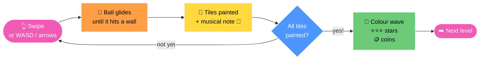
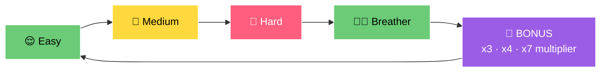
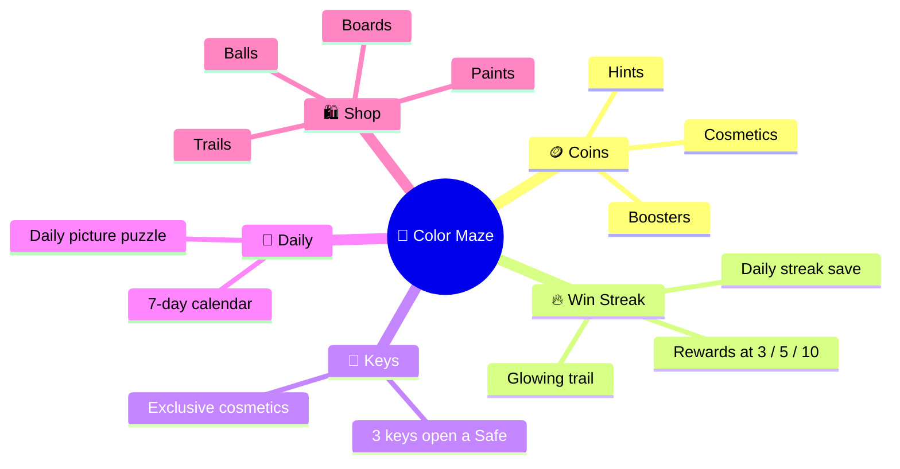

<p align="center">
  
</p>

<p align="center">
  
</p>

<p align="center">
  
</p>

<p align="center">
  
  
  
  
  
  
</p>

---

<p align="center">
  
</p>

---

<h2 align="center">🎮 HOW IT PLAYS</h2>



<p align="center">
⭐⭐⭐ <b>Optimal moves</b> &nbsp;·&nbsp; ⭐⭐ <b>Close</b> &nbsp;·&nbsp; ⭐ <b>Finished</b> — you always get at least one star.
</p>

---

<p align="center">
  
</p>



---

<p align="center">
  
</p>

---

<h2 align="center">🎁 PROGRESSION & REWARDS</h2>



<p align="center">
<b>🛍️ Animated boards:</b> 🌊 Ocean caustics · 🧊 Ice that melts under paint · 🌌 Night sky · 🌋 Lava pulse · 🌷 Garden · 💡 Neon edges<br/>
<sub>Real lit materials: wood, marble, terrazzo, grass, sand, felt, metal, glass, candy. Every board × paint combination passes a contrast check.</sub>
</p>

---

<p align="center">
  
</p>

```text
src/
├── game/        🎮 core mechanics, ball physics, painting
├── levels/      ♾️ seeded generator + solver
├── ui/          🖼️ clay buttons, frosted panels, spring transitions
├── audio/       🎵 musical painting + SFX
├── platform/    🌐 web portal SDK integration
└── assets/      🎨 sprites & fonts
scripts/
├── check-levels.ts      🤖 verify every level is solvable
├── check-mechanics.ts   🧪 mechanics regression tests
└── render-*.py          🖌️ procedural icon renders (coin, key, star…)
```

---

<h2 align="center">🚀 RUN IT</h2>

```bash
git clone https://github.com/vishwaMoger/Color-Maze.git
cd Color-Maze
npm install
npm run dev
```

| Command | What it does |
|:--|:--|
| `npm run dev` | 🔥 Start the dev server with hot reload |
| `npm run build` | 📦 Type-check and build for production |
| `npm test` | 🧪 Type-check, mechanics tests and verify 60 levels |
| `npm run check-levels` | 🤖 Run the level solver |
| `npm run build:crazygames` | 🌐 Build the web-portal package |

📄 Full design document: [`docs/DESIGN.md`](docs/DESIGN.md)

---

<p align="center">
  <b>Made with ❤️ and a lot of 🎨 by <a href="https://github.com/vishwaMoger">Vishwa Moger</a></b><br/>
  <sub>Game Developer · 3+ years · Bangalore, India</sub>
</p>


